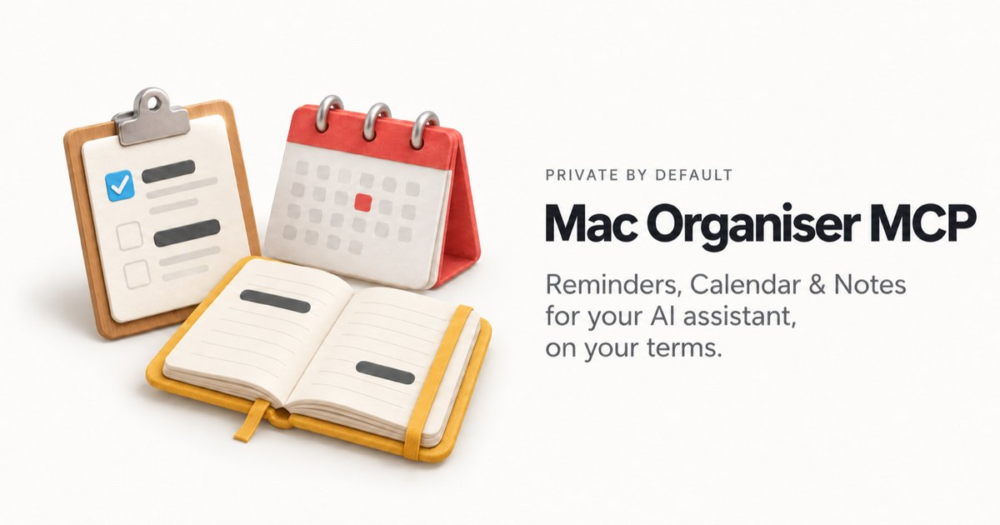
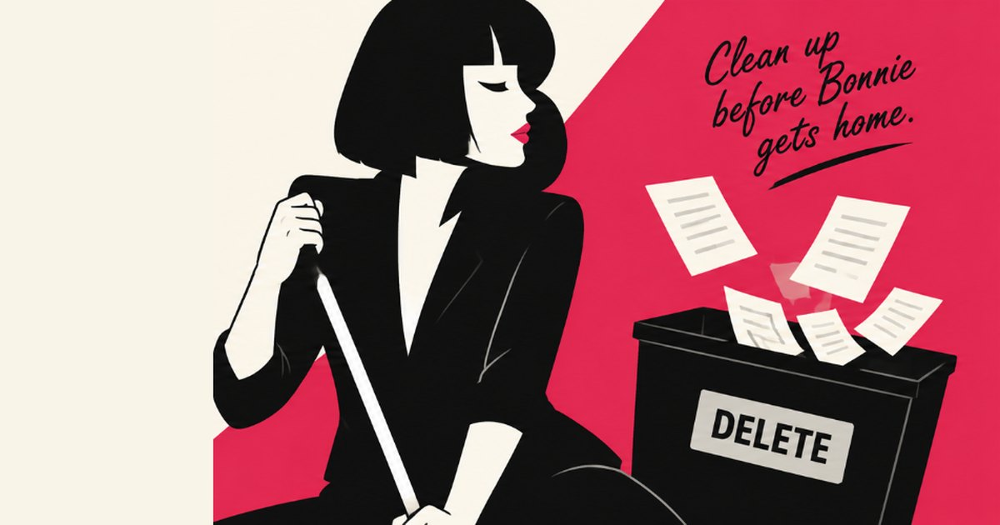
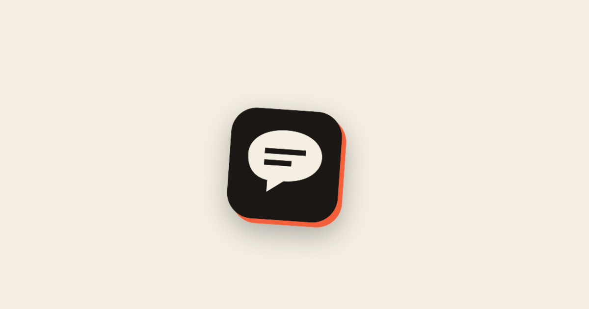
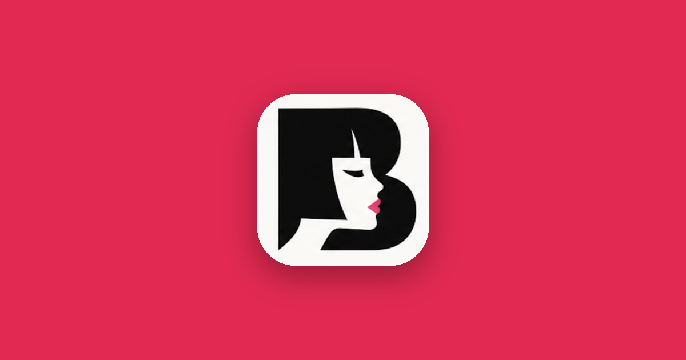
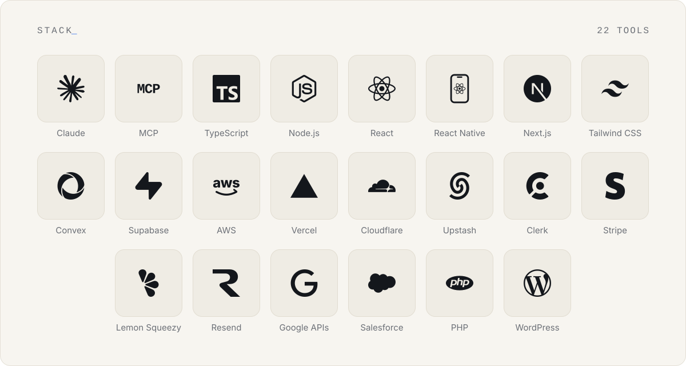

<picture>
  <source media="(prefers-color-scheme: dark)" srcset="./assets/header-dark.svg">
  
</picture>

**Tech Lead & indie builder.** 
Web dev, mobile apps, data engineering, and AI/agentic product work. 
Lately: MCP servers, privacy-first WordPress plugins and small SaaS for indie teams.

Melbourne, Australia

 

## About me

I'm a Tech Lead and indie builder based in Melbourne. My work spans web, mobile apps, data engineering and, more and more, AI and agentic products: assistants that do useful work without being handed the keys to everything.

Alongside that, I build and ship my own products. A few threads run through all of them. **Privacy by default:** [Mac Organiser MCP](https://github.com/nicksull/mac-organiser-mcp) makes zero network calls, and [The Bonnie Situation](https://github.com/nicksull/the-bonnie-situation) deletes form data once it's no longer needed. **Working inside the tools people already use:** [Hollaback](https://hollaback.me) sends feedback into Slack and Linear, and [Punchcard](https://usepunchcard.app) pushes hours straight into Xero. **Small and focused:** each one does one job well.

I've built for the web long enough to have shipped plenty of WordPress, and I still do. The Bonnie Situation is on WordPress.org, with [Bonnie Pro](https://beforebonnie.com) as its paid add-on.

Want to talk shop or work together? Find me on [LinkedIn](https://www.linkedin.com/in/nick-sull/) or at [nicksull.dev](https://nicksull.dev).

## Open source

<table>
<tr>
<td width="50%" valign="top">

### [Mac Organiser MCP](https://github.com/nicksull/mac-organiser-mcp)
Reminders, Calendar and Notes for your AI assistant, on your terms. It only sees the lists, calendars and folders you allow, nothing the model sends can run as code, and it makes zero network calls.

TypeScript · MCP · macOS

</td>
<td width="50%" valign="top">

### [The Bonnie Situation](https://github.com/nicksull/the-bonnie-situation)
Privacy-first storage for Contact Form 7 submissions on WordPress. Minimal capture by default, retention that actually deletes, and one-click import from Flamingo and CFDB7.

PHP · WordPress · on WordPress.org

</td>
</tr>
</table>

## Products

<table>
<tr>
<td width="50%" valign="top">

### [Hollaback](https://hollaback.me)
Feedback boards for indie builders. Drop a widget into any app, collect feature requests and bug reports in one place, upvote the signal, and send it to Slack and Linear.

Next.js · Convex 

</td>
<td width="50%" valign="top">

### [Punchcard](https://usepunchcard.app)
A Mac menu bar time tracker that pushes your hours straight into Xero Projects.

macOS · Xero 

</td>
</tr>
<tr>
<td width="50%" valign="top">

### [Wanderlist](https://mywanderlist.app)
A travel app for saving, organising and rediscovering places worth going.

iOS 

</td>
<td width="50%" valign="top">

### [Bonnie Pro](https://beforebonnie.com)
The paid add-on for The Bonnie Situation, built entirely on the free plugin's public hook API.

PHP · WordPress 

</td>
</tr>
</table>

<!-- Red Van Rush: add a card here on release. -->

## FAQ

<b>Who is Nick Sullivan?</b>

 

A Tech Lead and indie builder in Melbourne, Australia. I work across web, mobile apps, data engineering and AI/agentic products, and I build and ship my own software alongside that.

<b>What are you working on right now?</b>

 

[Hollaback](https://hollaback.me) is heading towards launch, [Punchcard](https://usepunchcard.app) has a waitlist open, and [Wanderlist](https://mywanderlist.app) and [Bonnie Pro](https://beforebonnie.com) are live.

<b>Which of your projects are open source?</b>

 

[Mac Organiser MCP](https://github.com/nicksull/mac-organiser-mcp) (MIT) and [The Bonnie Situation](https://github.com/nicksull/the-bonnie-situation) (GPLv2 or later). The products are closed source.

<b>Is Mac Organiser MCP safe to connect to my assistant?</b>

 

That's what it's designed for. Your assistant only sees the Reminders lists, calendars and Notes folders you allow, nothing the model sends can run as code, deletes are opt-in, and it makes zero network calls. The [README](https://github.com/nicksull/mac-organiser-mcp#private-by-default) explains how.

<b>How do I get The Bonnie Situation?</b>

 

Install it free from the WordPress.org plugin directory inside your WordPress admin. [Bonnie Pro](https://beforebonnie.com) adds the paid features on top.

<b>I found a bug. Where do I report it?</b>

 

For the open-source projects, open an issue on the repo. For the products, use the support page on each product's site.

<b>How do I get in touch?</b>

 

[LinkedIn](https://www.linkedin.com/in/nick-sull/) is best, or start at [nicksull.dev](https://nicksull.dev).

## Tech stack

<picture>
  <source media="(prefers-color-scheme: dark)" srcset="./assets/stack-dark.svg">
  
</picture>

## Connect

<a href="https://nicksull.dev"><picture><source media="(prefers-color-scheme: dark)" srcset="./assets/connect-website-dark.svg"></picture></a><a href="https://www.linkedin.com/in/nick-sull/"><picture><source media="(prefers-color-scheme: dark)" srcset="./assets/connect-linkedin-dark.svg"></picture></a><a href="https://www.instagram.com/nicksull/"><picture><source media="(prefers-color-scheme: dark)" srcset="./assets/connect-instagram-dark.svg"></picture></a>

