<picture>
  <source media="(prefers-color-scheme: dark)" srcset="./assets/header-dark.svg">
  
</picture>

**Tech Lead & indie builder.** 
Web dev, mobile apps, data engineering, and AI/agentic product work. 
Lately: MCP servers, privacy-first WordPress plugins and small SaaS for indie teams.

Melbourne, Australia · [nicksull.dev](https://nicksull.dev)

 

## Open source

<table>
<tr>
<td width="50%" valign="top">

### [Mac Organiser MCP](https://github.com/nicksull/mac-organiser-mcp)
Reminders, Calendar and Notes for your AI assistant, on your terms. It only sees the lists, calendars and folders you allow, nothing the model sends can run as code, and it makes zero network calls.

TypeScript · MCP · macOS

</td>
<td width="50%" valign="top">

### [The Bonnie Situation](https://github.com/nicksull/the-bonnie-situation)
Privacy-first storage for Contact Form 7 submissions on WordPress. Minimal capture by default, retention that actually deletes, and one-click import from Flamingo and CFDB7.

PHP · WordPress · on WordPress.org

</td>
</tr>
</table>

## Products

<table>
<tr>
<td width="50%" valign="top">

### [Hollaback](https://hollaback.me)
Feedback boards for indie builders. Drop a widget into any app, collect feature requests and bug reports in one place, upvote the signal, and send it to Slack and Linear.

Next.js · Convex · `Pre-launch`

</td>
<td width="50%" valign="top">

### [Punchcard](https://usepunchcard.app)
A Mac menu bar time tracker that pushes your hours straight into Xero Projects.

macOS · Xero · `Waitlist`

</td>
</tr>
<tr>
<td width="50%" valign="top">

### [Wanderlist](https://mywanderlist.app)
A travel app for saving, organising and rediscovering places worth going.

iOS · `Live`

</td>
<td width="50%" valign="top">

### [Bonnie Pro](https://beforebonnie.com)
The paid add-on for The Bonnie Situation, built entirely on the free plugin's public hook API.

PHP · WordPress · `Live`

</td>
</tr>
</table>

<!-- Red Van Rush: add a card here on release. -->

 

<a href="https://nicksull.dev">nicksull.dev</a>

